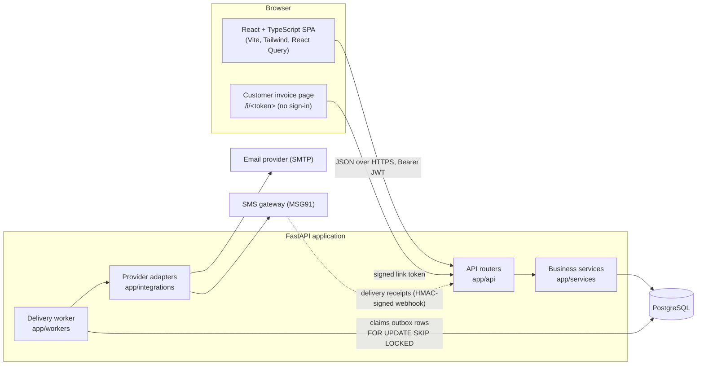

# Architecture

## Overview

## Backend layout (`backend/app`)

| Package | Responsibility |
|---|---|
| `core/` | Configuration (environment only), database session, JWT and password hashing, permission matrix, rate limiter, money helpers |
| `models/` | SQLAlchemy models, grouped by domain (`user`, `customer`, `job`, `inventory`, `billing`, `comms`, `system`) |
| `schemas/` | Pydantic request and response models; all input validation lives here |
| `api/` | Thin HTTP routers: authorise, call a service, commit, serialise |
| `services/` | Business rules: `jobs` (state machine), `inventory`, `estimates`, `billing`, `delivery`, `invoice_pdf`, `reports`, `settings`, `bootstrap`, `common` (audit, notifications, numbering) |
| `integrations/` | Email and SMS provider interface, SMTP and MSG91 adapters, development simulators, provider registry |
| `workers/` | The invoice-delivery worker loop |
| `templates/` | Invoice email (HTML and plain text) |

There is no separate repository layer: services use the SQLAlchemy session directly. Queries that matter for correctness (locks, counters, outbox claims) sit next to the rule they protect.

## Frontend layout (`frontend/src`)

| Folder | Responsibility |
|---|---|
| `services/api.ts` | Fetch client, in-memory access token, single-flight refresh, error parsing |
| `hooks/` | `useAuth` (session, permission checks), `useListParams` (filters in the URL) |
| `components/` | UI kit (`ui.tsx`: buttons, cards, modal, confirm dialog, toasts, status badge) and `DataTable` (TanStack Table) |
| `layouts/` | Sidebar + top bar shell with role-filtered navigation |
| `features/job`, `features/invoice` | Job-card tabs, invoice document, delivery panel |
| `pages/` | One file per screen (or small group of screens) |
| `validation/` | Zod schemas used with React Hook Form |
| `types/` | API types |

## Authentication and authorisation

- Passwords are hashed with bcrypt. Sign-in returns a 30-minute JWT access token (kept in memory by the SPA) and sets a single-use, rotating refresh token as an `httpOnly`, `SameSite=Strict` cookie scoped to `/api/auth`.
- Every request reloads the user, so deactivating an account or changing its role takes effect immediately; refresh tokens are revoked at the same time.
- Four roles exist. Their permissions are defined once in `core/permissions.py`, synchronised into the `roles` / `permissions` / `role_permissions` tables, and checked by the `require(...)` dependency on each endpoint. The frontend hides what a role cannot use, but the API is the authority.
- Record-level rule: a mechanic can read and change only jobs assigned to them; other jobs return 404.
- The Administrator role has no billing, stock or job permissions, and every administrator action is written to the audit log.

## Invoice delivery (outbox)

1. `billing.finalise` runs in one transaction: lock the invoice and job, re-check billing blockers, rebuild lines from verified data, allocate the invoice number, issue the customer link, insert one `delivery_jobs` row for email and one for SMS, write the audit entry. No provider is contacted.
2. The worker (`delivery.run_once`) claims due rows with `FOR UPDATE SKIP LOCKED`, marks them `QUEUED` with a five-minute claim, commits, then sends each one with no lock held.
3. The outcome is recorded in a second transaction together with a `communication_attempts` row:
   - accepted by the provider: `SENT` (never `DELIVERED`);
   - temporary failure: `RETRY_SCHEDULED` with exponential backoff (base delay doubles each attempt, capped at six hours) until `delivery_max_attempts`;
   - permanent failure or attempts exhausted: `FAILED`, and Service Managers are notified.
4. A verified receipt webhook moves `SENT` to `DELIVERED` or `FAILED`. Callbacks are de-duplicated by `(provider, event_id)`.

Duplicate protection: each delivery job carries one idempotency key that is passed to the provider on every attempt; a claimed row cannot be claimed by a second worker; a manual resend is refused while a delivery on that channel is in progress and is rate-limited per invoice and channel.

Known limit: if a worker process dies after the provider accepted a message but before the result was committed, the job is retried after the claim expires. The repeat is suppressed only if the provider honours the idempotency key. The SMTP adapter sends it as an `X-Idempotency-Key` header, which most relays ignore, and the MSG91 adapter has no idempotency parameter to pass it in, so in that narrow crash window a customer could receive the same message twice.

## Design decisions worth knowing

- **Sync SQLAlchemy** with FastAPI's thread pool: simpler transaction and locking code than async, and adequate for a service centre's load.
- **Explicit commits in routers**: a request either commits everything (business change, audit entry, notifications, outbox rows) or nothing.
- **Provider selection and credentials are environment-only.** The Administrator screen edits non-secret settings (sender name, SMS sender ID, DLT template ID, public URL, link expiry, retry policy) and shows the provider configuration read-only. This deviates from "configure the provider in the UI" on purpose: it keeps credentials and endpoints out of the database and the browser.
- **In-process rate limiter** for sign-in and public links. It is per process; behind several API processes, also rate-limit at the reverse proxy.
