# Database schema

PostgreSQL, managed by Alembic migrations in `backend/alembic/versions`:

| Revision | Purpose |
|---|---|
| `0001` | All tables, foreign keys, indexes, unique and check constraints |
| `0002` | Append-only triggers on `audit_logs`, `communication_attempts`, `inventory_movements`, `customer_consents` |

## Design notes

- **Money** is `NUMERIC(14,2)`, quantities `NUMERIC(12,2)`, tax rates `NUMERIC(5,2)`. Python uses `Decimal` with half-up rounding to paise; the API sends amounts as strings.
- **Statuses** are stored as strings (see `backend/app/models/enums.py`), so adding a status needs no enum migration.
- **Estimate versions**: each `estimates` row is one version for a job (`unique(job_id, version)`); superseded versions are kept.
- **Delivery jobs**: email and SMS deliveries share `delivery_jobs`, distinguished by `channel`. Every provider call is one `communication_attempts` row.
- **Invoice links**: `invoice_links.public_id` is random; the URL token is `public_id.HMAC(public_id)` with a server-side secret, so database contents alone cannot open an invoice.
- **Stock**: `inventory_stock` has one row per part with `CHECK` constraints (`qty_on_hand >= 0`, `qty_reserved >= 0`, `qty_reserved <= qty_on_hand`). Available quantity is computed as on hand minus reserved, never stored.
- **Invoices**: a partial unique index allows at most one non-cancelled invoice per job. Customer, vehicle and service-centre details are copied onto the invoice at finalisation.
- **Numbering**: `document_counters(scope, year)` is incremented with `INSERT ... ON CONFLICT DO UPDATE ... RETURNING` inside the creating transaction, giving unique, gap-free numbers under concurrency.
- **Transactions and locks**: job creation locks the vehicle row; stock changes lock the parts-request line and then the stock row (`SELECT ... FOR UPDATE`); invoice finalisation, payments and resends lock the invoice row; the delivery worker claims rows with `FOR UPDATE SKIP LOCKED`.

## Entity-relationship diagram

Generated from the SQLAlchemy models (`backend/app/models`). Each line is a foreign key; the label is the referencing column.

```mermaid
erDiagram
    tax_rates |o--o{ labour_operations : tax_rate
    part_categories |o--o{ parts : category
    suppliers |o--o{ parts : supplier
    tax_rates |o--o{ parts : tax_rate
    permissions ||--o{ role_permissions : permission
    roles ||--o{ role_permissions : role
    roles ||--o{ users : role
    customers ||--o{ vehicles : customer
    vehicle_models ||--o{ vehicles : model
    users |o--o{ audit_logs : actor
    customers ||--o{ customer_consents : customer
    users |o--o{ customer_consents : recorded_by
    parts ||--o| inventory_stock : part
    users ||--o{ notifications : recipient
    parts ||--o{ part_compatibility : part
    vehicle_models ||--o{ part_compatibility : vehicle_model
    users ||--o{ purchase_requests : created_by
    users |o--o{ purchase_requests : decided_by
    suppliers |o--o{ purchase_requests : supplier
    users ||--o{ refresh_tokens : user
    users |o--o{ service_jobs : assigned_mechanic
    users ||--o{ service_jobs : created_by
    customers ||--o{ service_jobs : customer
    users |o--o{ service_jobs : handover_by
    vehicles ||--o{ service_jobs : vehicle
    users |o--o{ settings : updated_by
    users ||--o{ estimates : created_by
    service_jobs ||--o{ estimates : job
    service_jobs ||--o| inspections : job
    users ||--o{ inspections : mechanic
    users |o--o{ invoices : cancelled_by
    users ||--o{ invoices : created_by
    customers ||--o{ invoices : customer
    users |o--o{ invoices : finalised_by
    service_jobs ||--o{ invoices : job
    invoices |o--o{ invoices : replaces_invoice
    users ||--o{ job_assignments : assigned_by
    service_jobs ||--o{ job_assignments : job
    users ||--o{ job_assignments : mechanic
    users |o--o{ job_events : actor
    service_jobs ||--o{ job_events : job
    users ||--o{ job_labour : added_by
    service_jobs ||--o{ job_labour : job
    labour_operations |o--o{ job_labour : labour_operation
    tax_rates |o--o{ job_labour : tax_rate
    service_jobs ||--o{ job_photos : job
    users ||--o{ job_photos : uploaded_by
    service_jobs ||--o{ parts_requests : job
    users ||--o{ parts_requests : requested_by
    users ||--o{ quality_inspections : inspector
    service_jobs ||--o{ quality_inspections : job
    service_jobs ||--o{ work_completions : job
    users ||--o{ work_completions : mechanic
    estimates ||--o{ customer_approvals : estimate
    service_jobs ||--o{ customer_approvals : job
    users ||--o{ customer_approvals : recorded_by
    users |o--o{ invoice_links : created_by
    invoices ||--o{ invoice_links : invoice
    parts |o--o{ parts_request_lines : alt_part
    parts |o--o{ parts_request_lines : original_part
    parts ||--o{ parts_request_lines : part
    parts_requests ||--o{ parts_request_lines : request
    invoices ||--o{ payments : invoice
    users ||--o{ payments : recorded_by
    users |o--o{ payments : voided_by
    quality_checklist_items ||--o{ quality_inspection_results : checklist_item
    quality_inspections ||--o{ quality_inspection_results : inspection
    invoices ||--o{ delivery_jobs : invoice
    invoice_links |o--o{ delivery_jobs : link
    users |o--o{ delivery_jobs : requested_by
    estimates ||--o{ estimate_lines : estimate
    job_labour |o--o{ estimate_lines : job_labour
    parts_request_lines |o--o{ estimate_lines : parts_request_line
    service_jobs |o--o{ inventory_movements : job
    parts ||--o{ inventory_movements : part
    parts_request_lines |o--o{ inventory_movements : parts_request_line
    users ||--o{ inventory_movements : performed_by
    purchase_requests |o--o{ inventory_movements : purchase_request
    invoices ||--o{ invoice_lines : invoice
    job_labour |o--o{ invoice_lines : job_labour
    parts_request_lines |o--o{ invoice_lines : parts_request_line
    parts ||--o{ purchase_request_lines : part
    parts_request_lines |o--o{ purchase_request_lines : parts_request_line
    purchase_requests ||--o{ purchase_request_lines : purchase_request
    delivery_jobs ||--o{ communication_attempts : delivery_job
```

## Tables

| Table | Columns | Unique / check constraints |
|---|---|---|
| `audit_logs` | `id` PK, `actor_id` -> users, `actor_email`, `actor_role`, `action`, `entity_type`, `entity_id`, `summary`, `details`, `created_at` | - |
| `communication_attempts` | `id` PK, `delivery_job_id` -> delivery_jobs, `attempt_number`, `started_at`, `finished_at`, `outcome`, `provider`, `provider_message_id`, `error` | - |
| `customer_approvals` | `id` PK, `job_id` -> service_jobs, `estimate_id` -> estimates, `decision`, `method`, `notes`, `recorded_by_id` -> users, `decided_at` | - |
| `customer_consents` | `id` PK, `customer_id` -> customers, `channel`, `purpose`, `granted`, `source`, `recorded_by_id` -> users, `recorded_at` | - |
| `customers` | `id` PK, `code`, `name`, `mobile`, `email`, `alternate_mobile`, `billing_address`, `email_opt_in`, `sms_opt_in`, `created_at`, `updated_at` | unique(code); unique `code` |
| `delivery_jobs` | `id` PK, `invoice_id` -> invoices, `link_id` -> invoice_links, `channel`, `destination`, `status`, `trigger`, `attempt_count`, `max_attempts`, `next_attempt_at`, `locked_until`, `provider`, `provider_message_id`, `receipts_supported`, `simulated`, `last_error`, `last_attempt_at`, `sent_at`, `delivered_at`, `idempotency_key`, `requested_by_id` -> users, `created_at`, `updated_at` | unique(idempotency_key); unique `idempotency_key` |
| `document_counters` | `scope` PK, `year` PK, `last_value` | - |
| `estimate_lines` | `id` PK, `estimate_id` -> estimates, `line_type`, `job_labour_id` -> job_labour, `parts_request_line_id` -> parts_request_lines, `code`, `description`, `quantity`, `unit_price`, `discount_amount`, `tax_rate`, `tax_amount`, `line_total` | - |
| `estimates` | `id` PK, `job_id` -> service_jobs, `version`, `status`, `notes`, `terms`, `subtotal_labour`, `subtotal_parts`, `discount_total`, `tax_total`, `total`, `created_by_id` -> users, `sent_at`, `decided_at`, `created_at`, `updated_at` | unique(job_id, version) |
| `inspections` | `id` PK, `job_id` -> service_jobs, `mechanic_id` -> users, `initial_observations`, `diagnostic_findings`, `recommended_repairs`, `safety_observations`, `additional_recommendations`, `mechanic_notes`, `priority`, `submitted_at`, `created_at`, `updated_at` | unique(job_id); unique `job_id` |
| `inventory_movements` | `id` PK, `part_id` -> parts, `movement_type`, `quantity`, `on_hand_after`, `reserved_after`, `job_id` -> service_jobs, `parts_request_line_id` -> parts_request_lines, `purchase_request_id` -> purchase_requests, `reason`, `performed_by_id` -> users, `created_at` | - |
| `inventory_stock` | `part_id` PK -> parts, `qty_on_hand`, `qty_reserved`, `updated_at` | check: qty_reserved >= 0; check: qty_on_hand >= 0; check: qty_reserved <= qty_on_hand |
| `invoice_lines` | `id` PK, `invoice_id` -> invoices, `sort_order`, `line_type`, `job_labour_id` -> job_labour, `parts_request_line_id` -> parts_request_lines, `code`, `description`, `quantity`, `unit_price`, `discount_amount`, `tax_name`, `tax_rate`, `tax_amount`, `line_total` | - |
| `invoice_links` | `id` PK, `invoice_id` -> invoices, `public_id`, `expires_at`, `revoked_at`, `created_by_id` -> users, `created_at`, `last_accessed_at`, `access_count` | unique(public_id); unique `public_id` |
| `invoices` | `id` PK, `invoice_number`, `job_id` -> service_jobs, `customer_id` -> customers, `status`, `payment_status`, `customer_name`, `customer_email`, `customer_mobile`, `billing_address`, `vehicle_registration`, `vehicle_model`, `job_number`, `centre`, `subtotal_labour`, `subtotal_parts`, `discount_total`, `taxable_total`, `tax_total`, `total`, `amount_paid`, `notes`, `terms`, `created_by_id` -> users, `finalised_at`, `finalised_by_id` -> users, `cancelled_at`, `cancelled_by_id` -> users, `cancel_reason`, `replaces_invoice_id` -> invoices, `created_at`, `updated_at` | unique(invoice_number); unique `invoice_number`; partial unique index `uq_invoices_job_live` |
| `job_assignments` | `id` PK, `job_id` -> service_jobs, `mechanic_id` -> users, `assigned_by_id` -> users, `assigned_at`, `unassigned_at`, `notes` | - |
| `job_events` | `id` PK, `job_id` -> service_jobs, `event_type`, `message`, `from_status`, `to_status`, `actor_id` -> users, `created_at` | - |
| `job_labour` | `id` PK, `job_id` -> service_jobs, `labour_operation_id` -> labour_operations, `code`, `description`, `estimated_hours`, `actual_hours`, `hourly_rate`, `tax_rate_id` -> tax_rates, `approval_status`, `is_additional`, `added_by_id` -> users, `notes`, `created_at`, `updated_at` | - |
| `job_photos` | `id` PK, `job_id` -> service_jobs, `stored_name`, `original_name`, `content_type`, `size_bytes`, `uploaded_by_id` -> users, `created_at` | unique(stored_name); unique `stored_name` |
| `labour_operations` | `id` PK, `code`, `name`, `description`, `default_hours`, `hourly_rate`, `tax_rate_id` -> tax_rates, `is_active` | unique(code); unique `code` |
| `notifications` | `id` PK, `recipient_id` -> users, `type`, `title`, `message`, `entity_type`, `entity_id`, `is_read`, `read_at`, `created_at` | - |
| `part_categories` | `id` PK, `name`, `is_active` | unique(name); unique `name` |
| `part_compatibility` | `part_id` PK -> parts, `vehicle_model_id` PK -> vehicle_models | - |
| `parts` | `id` PK, `sku`, `name`, `description`, `category_id` -> part_categories, `purchase_cost`, `selling_price`, `tax_rate_id` -> tax_rates, `reorder_threshold`, `supplier_id` -> suppliers, `storage_location`, `is_active`, `created_at`, `updated_at` | unique(sku); unique `sku` |
| `parts_request_lines` | `id` PK, `request_id` -> parts_requests, `part_id` -> parts, `original_part_id` -> parts, `description`, `qty_requested`, `qty_approved`, `qty_reserved`, `qty_issued`, `qty_returned`, `qty_consumed`, `urgency`, `notes`, `status`, `approval_status`, `is_short`, `expected_restock_date`, `inventory_notes`, `alt_part_id` -> parts, `alt_status`, `alt_notes`, `cancel_reason`, `created_at`, `updated_at` | check: qty_issued <= qty_requested; check: qty_reserved >= 0 AND qty_issued >= 0 AND qty_returned >= 0; check: qty_returned <= qty_issued; check: qty_requested > 0 |
| `parts_requests` | `id` PK, `request_number`, `job_id` -> service_jobs, `requested_by_id` -> users, `status`, `is_additional`, `notes`, `created_at`, `updated_at` | unique(request_number); unique `request_number` |
| `payments` | `id` PK, `reference`, `invoice_id` -> invoices, `amount`, `method`, `paid_at`, `external_reference`, `notes`, `recorded_by_id` -> users, `idempotency_key`, `voided_at`, `voided_by_id` -> users, `void_reason`, `created_at` | unique(idempotency_key); unique(reference); unique `reference`; unique `idempotency_key` |
| `permissions` | `id` PK, `code`, `description` | unique(code); unique `code` |
| `purchase_request_lines` | `id` PK, `purchase_request_id` -> purchase_requests, `part_id` -> parts, `quantity`, `qty_received`, `unit_cost`, `parts_request_line_id` -> parts_request_lines | - |
| `purchase_requests` | `id` PK, `pr_number`, `supplier_id` -> suppliers, `status`, `notes`, `created_by_id` -> users, `decided_by_id` -> users, `decided_at`, `decision_notes`, `received_at`, `created_at`, `updated_at` | unique(pr_number); unique `pr_number` |
| `quality_checklist_items` | `id` PK, `label`, `category`, `is_active`, `sort_order` | - |
| `quality_inspection_results` | `id` PK, `inspection_id` -> quality_inspections, `checklist_item_id` -> quality_checklist_items, `label`, `passed`, `notes` | unique(inspection_id, checklist_item_id) |
| `quality_inspections` | `id` PK, `job_id` -> service_jobs, `inspector_id` -> users, `result`, `reason`, `road_test_notes`, `created_at` | - |
| `refresh_tokens` | `id` PK, `user_id` -> users, `token_hash`, `expires_at`, `revoked_at`, `created_at` | unique(token_hash); unique `token_hash` |
| `role_permissions` | `role_id` PK -> roles, `permission_id` PK -> permissions | - |
| `roles` | `id` PK, `code`, `name`, `description` | unique(code); unique `code` |
| `service_jobs` | `id` PK, `job_number`, `customer_id` -> customers, `vehicle_id` -> vehicles, `visit_at`, `odometer`, `fuel_level`, `complaints`, `condition_notes`, `priority`, `status`, `status_before_hold`, `assigned_mechanic_id` -> users, `estimated_completion_at`, `created_by_id` -> users, `active_job_override_reason`, `hold_reason`, `cancel_reason`, `rework_count`, `returned_for_rework`, `ready_for_delivery_at`, `delivered_at`, `handover_to`, `handover_notes`, `handover_by_id` -> users, `created_at`, `updated_at` | unique(job_number); unique `job_number` |
| `settings` | `key` PK, `value`, `updated_at`, `updated_by_id` -> users | - |
| `suppliers` | `id` PK, `name`, `contact_name`, `phone`, `email`, `address`, `is_active` | unique(name); unique `name` |
| `tax_rates` | `id` PK, `name`, `rate`, `is_active` | unique(name); unique `name` |
| `users` | `id` PK, `email`, `full_name`, `phone`, `password_hash`, `role_id` -> roles, `is_active`, `is_demo`, `last_login_at`, `created_at`, `updated_at` | unique(email); unique `email` |
| `vehicle_models` | `id` PK, `name`, `is_active`, `sort_order` | unique(name); unique `name` |
| `vehicles` | `id` PK, `registration_number`, `model_id` -> vehicle_models, `customer_id` -> customers, `vin`, `engine_number`, `odometer`, `is_active`, `created_at`, `updated_at` | unique(vin); unique(registration_number); unique `registration_number`; unique `vin` |
| `webhook_events` | `id` PK, `provider`, `event_id`, `payload`, `received_at` | unique(provider, event_id) |
| `work_completions` | `id` PK, `job_id` -> service_jobs, `mechanic_id` -> users, `repairs_completed`, `outstanding_issues`, `final_observations`, `completed_at` | - |
