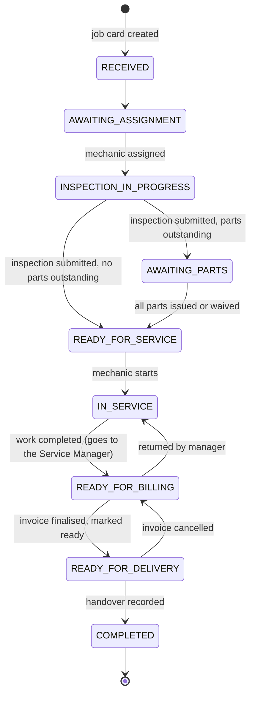

# Workflow

## Job status machine

Every status change goes through `services/jobs.py::transition`, which rejects anything not listed in `TRANSITIONS` and writes a timeline event with the user responsible.

`ON_HOLD` and `CANCELLED` can be reached from any status before `READY_FOR_DELIVERY`; a held job resumes only to the status it had. There is no quality-inspection step: when the mechanic completes the work the job goes straight to `READY_FOR_BILLING` and the Service Manager is notified. `AWAITING_QUALITY_CHECK` and `AWAITING_MANAGER_REVIEW` remain in the vocabulary only for old records.

A job with no parts never waits for inventory. There is no customer-approval step: submitting the inspection releases the work. `AWAITING_ESTIMATE_APPROVAL` remains in the vocabulary only for old records.

## Who does what

**Direct billing.** For quick jobs (a wash, a small fitment, a parts sale) the Service Manager can bill without the inspection and workshop steps: *Bill directly* on the dashboard (finds the vehicle, opens a job card) or on an open job card. The job moves straight to `READY_FOR_BILLING` with a completion note and a timeline entry, and a draft invoice opens for the manager to add items and finalise. The normal billing checks still apply: stock issued but not recorded as used or returned, or a spare parts list still waiting for inventory, blocks it.

**Mechanics do not use the software.** The Service Manager assigns a mechanic to each job and records that mechanic's inspection, labour, additional parts, service start and completion on the job card; the inspection and completion are credited to the assigned mechanic. Mechanic accounts exist only so they can be assigned and appear in reports; they cannot sign in. Rows below marked "Mechanic" are therefore entered by the Service Manager.

| Step | Role | Screen | Rules enforced by the API |
|---|---|---|---|
| Search registration, register customer and vehicle | Service Manager | New Service Visit | Registration normalised (`MH 12-AB 1234` = `MH12AB1234`) and unique; Indian mobile validated |
| Create job card | Service Manager | New Service Visit | Second active job on a vehicle needs a recorded override reason; number allocated safely under concurrency |
| Assign mechanic | Service Manager | Job card | Target must be an active mechanic; mechanic is notified |
| Inspect (recommended repairs, hand-written spare parts, priority), add labour, submit | Mechanic | Job card: Inspection | Only the assigned mechanic; recommended repairs required; on submit a non-empty written parts list goes to inventory (notification + Parts Requests page) and the job waits in `AWAITING_PARTS` |
| Check a written spare parts list by hand | Inventory Staff | Parts Requests: Spare parts lists | No catalogue or stock figures: staff check the shelf and either mark it **Available**, entering each part's name, quantity, unit, rate, HSN and tax (billed on the invoice as entered, correctable until invoiced), or **Not available** with a note (mechanic and manager notified; the job keeps waiting and can be checked again later). Editing the list after submission sends it again |
| Request catalogue parts from inventory | Mechanic | Job card: Parts | Requesting never changes stock; inventory is notified |
| Prepare estimate (optional quote) | Service Manager | Job card: Estimate | Discount limit; revisions create a new version; never blocks the work |
| Reserve, issue, record shortage, propose alternative | Inventory Staff | Parts Requests | Cannot exceed available or requested quantity; rows locked against double issue |
| Approve alternative part or purchase request | Service Manager | Job card: Parts, Purchase Requests | The creator of a purchase request cannot approve it |
| Receive stock | Inventory Staff | Purchase Requests, Parts Catalogue | Only against an approved request, or as a recorded receipt |
| Start service, add additional work, complete | Mechanic | Job card: Work | Additional labour and parts go ahead immediately and are billed; parts consumed cannot exceed issued |
| Take back unused parts | Inventory Staff | Parts Requests | Only up to issued minus consumed minus already returned |
| Review completed work; return it if needed | Service Manager | Job card | Completed work arrives as `READY_FOR_BILLING`; "Return to mechanic" needs a reason and sends the job back to `IN_SERVICE` (not after the invoice is finalised) |
| Prepare, review and finalise invoice | Service Manager | Invoice | Blocked until the work is completed and parts are reconciled; finalised invoices are immutable |
| Email and SMS delivery | System | Invoice: Delivery | Queued in the finalisation transaction; channels independent |
| Retry, resend, reissue link | Service Manager | Invoice: Delivery | Retry only for failed deliveries; resend needs confirmation and is rate-limited |
| Record payments | Service Manager | Invoice | Cannot exceed the outstanding balance; idempotency key prevents double entry; voids keep the entry |
| Mark ready, record handover | Service Manager | Job card: Billing | Needs a finalised invoice; handover with a balance outstanding needs explicit confirmation |

## Parts request line states

A line tracks `qty_requested`, `qty_reserved`, `qty_issued`, `qty_returned` and `qty_consumed`.

- Outstanding = requested - issued.
- Unreconciled = issued - returned - consumed. It must be zero before the job can be invoiced.
- Line status is derived: `PENDING`, `PARTIALLY_RESERVED`, `RESERVED`, `PARTIALLY_ISSUED`, `ISSUED`, `UNAVAILABLE` (shortage recorded, nothing reserved), `CANCELLED`.
- Request status is derived from its lines: `PENDING`, `PARTIALLY_FULFILLED`, `FULFILLED`, `UNAVAILABLE`, `CANCELLED`.
- Example: three parts requested, two in stock. Two lines are issued, the third stays outstanding with a shortage and expected restock date, the request shows `PARTIALLY_FULFILLED`, and the job stays `AWAITING_PARTS` until the third is issued, replaced by an approved alternative, or cancelled by the Service Manager.

Every stock change writes an `inventory_movements` row: `RECEIVED`, `RESERVED`, `ISSUED`, `RETURNED`, `RESERVATION_RELEASED`, `ADJUSTMENT`, `WRITE_OFF`.

## Estimates and additional work

- There is no customer-approval step. An estimate is an optional quote the Service Manager can prepare, discount and print at any time from inspection until the work is completed. It never blocks issuing parts or starting work.
- Each "Update estimate" creates a new version; earlier versions are kept as `SUPERSEDED`.
- Work added while the job is `IN_SERVICE` goes ahead immediately: inventory can issue the added parts and the work is billed. The Service Manager is notified ("Additional work added"). The mechanic can remove added labour or cancel unissued part lines before completing.
- Estimates and customer-approval records created before this change are kept for history.

## Invoice rules

- Labour lines: the job's labour operations, billed at their estimated hours (editable by the mechanic until the work is completed) and the catalogue rate captured when the operation was added.
- Part lines: quantity actually consumed, at the part's selling price. The requested quantity is never used.
- Each line carries its own tax rate. Line tax = (quantity x rate - discount) x tax %, rounded half-up to paise. Totals are sums of line values.
- Finalised invoices cannot be edited. To correct one: void its payments, cancel it with a reason (number retained as cancelled, links revoked), then prepare and finalise a new invoice. Credit notes are not implemented.

## Delivery statuses

| Status | Meaning |
|---|---|
| `PENDING` | In the outbox, not yet attempted |
| `QUEUED` | Claimed by a worker, being sent |
| `SENT` | Provider accepted the message. Shown as "awaiting receipt", or "delivery unconfirmed" when the provider cannot send receipts, or "Simulated (not sent)" in development |
| `DELIVERED` | A verified provider receipt confirmed delivery |
| `RETRY_SCHEDULED` | Temporary failure; another attempt is scheduled |
| `FAILED` | Permanent failure, attempts exhausted, or contact details missing or invalid |
| `SKIPPED` | Customer opted out of the channel |
| `CANCELLED` | Invoice cancelled before sending |

## Notifications

In-app notifications are stored per recipient with read state and a link to the record: job assigned, parts request, partial issue, parts unavailable, alternative proposed and decided, purchase request and decision, stock received, inspection submitted, additional work added, work completed (ready for billing), job returned, ready for billing, ready for delivery, invoice email failed, invoice SMS failed, low stock, unused parts due back. They are separate from customer email and SMS deliveries.
